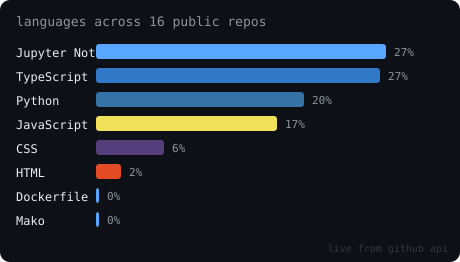

<div align="center">




[](https://git.io/typing-svg)


<p>
  <a href="https://www.linkedin.com/in/gargi-joshi-a9246b331"></a>
  <a href="https://gargijoshi9.github.io/myportfolio/"></a>
  <a href="https://github.com/gargijoshi9"></a>
  <a href="mailto:gargijoshi0902@gmail.com"></a>
</p>


</div>

## Summary

Pre-final year B.Tech IT student at PICT Pune with a Minor in Finance and a **9.42 CGPA**. I focus on AI/ML and software engineering. I turn messy, real-world data into models and insights people can actually use, and I build the full-stack systems to ship them when needed.

 


## Professional Experience

### Research Intern & Team Lead · AWS Cloud Club, PICT Pune
*Aug 2026 – Oct 2026*
* Led a **6-member research team** building a carbon-aware cloud scheduling system on **140,000+ Azure VM trace records**.
* Built a workload forecasting pipeline comparing **3 models**; the Differenced Ridge model cut error (MAE) by **10.9%** against the baseline.
* Implemented a rule-based **scheduling prototype** that shifted **21 of 484 workloads** into lower-carbon time windows.
* Applied INT8 quantization to a 75K-parameter PyTorch model, reaching **72.34% lower memory usage** and **42.5% lower latency**.

### Website Developer Intern · Thyright Innovations Pvt. Ltd.
*Nov 2025 – Jan 2026 | Remote*
* Built **13+ responsive webpages** from founder requirements, serving **500+ monthly users**.
* Integrated **PayPal & Razorpay** payments to support online transactions.
* Improved on-page SEO and applied **DPDP Act**-compliant data handling.
* Cut UI defects by **40%** through cross-browser testing on 5+ devices.

### Open Source Contributor · GSSoC '25
*Aug 2025 – Nov 2025 | Remote*
* Fixed **12+ UI inconsistencies** across 8 React components to improve responsiveness.
* Got **2 pull requests merged** into production repositories.

---

## Technical Skills

<div align="left">

### Languages
<p>
  
</p>

### AI & Machine Learning
<p>
  
</p>

<p>
  
  
  
  
</p>

### Full-Stack Development
<p>
  
</p>

### Databases & Cloud
<p>
  
</p>

### Tools & Platforms
<p>
  
</p>

</div>
----

## Projects

### MuleRadar — AI Mule Detection Platform
[GitHub](https://github.com/gargijoshi9/BOI) · *BOI 2026 Hackathon Finalist, Top 31 Nationwide*
 
```yaml
stack: Python, XGBoost, LightGBM, CatBoost, Isolation Forest, SHAP, FastAPI, React
```
 
- Built a fraud detection system with a **4-member team** to flag money mule accounts; only **0.89%** of the 9,082 accounts were mules.
- Cleaned the raw data, removed leaked columns, and cut **3,861 features to 72** with a 4-stage feature selection pipeline.
- Combined XGBoost, LightGBM, CatBoost, and Isolation Forest into an ensemble, reaching **0.98 ROC-AUC** and **0.80 PR-AUC**.
- Used **SHAP** to explain each flagged account, and built an **AI investigator copilot** that turns those explanations into audit-ready suspicious activity reports.
### Nexus Ops — Multi-Tenant Enterprise Portal
[GitHub](https://github.com/gargijoshi9/unified-workspace) · [Live Demo](https://unified-workspace.vercel.app/)
 
```yaml
stack: Next.js, TypeScript, PostgreSQL, Prisma, Redis, NextAuth
```
 
- Solo-built a portal where companies manage support tickets and code reviews, with **25+ API endpoints**.
- Designed **5-role RBAC** with tenant-scoped queries, so no company can see another's data (**BOLA** protection).
- Used **Redis** session versioning so one logout signs a user out of every device instantly.
- Added an append-only audit log and **10 automated test suites (172 assertions)** covering tenant isolation, roles, and session security.
### QuantumLab — Quantum Learning Platform
[GitHub](https://github.com/DJ-007-WEB/Corkscrew_SIH26-QuantumLab) · *SIH 2026*
 
```yaml
stack: Python, FastAPI, React, TypeScript, Qiskit, Three.js, LLM
```
 
- Built a full-stack quantum learning platform with **Qiskit Aer (up to 8 qubits)**.
- Created interactive **Three.js Bloch Sphere and Q-Sphere** visualizers with configurable shot sampling (128–8192).
- Designed an **AI tutor** where Qiskit computes verified circuit facts before the LLM answers, with an offline fallback.
- Added an adaptive assessment engine (IRT + BKT), JWT role-based login, and an instructor dashboard.
### ExoScope — Exoplanet Transit Detection & Classification
[GitHub](https://github.com/gargijoshi9/exoplanet-detection)
 
```yaml
stack: Python, LightGBM, Scikit-learn, Pandas, NumPy, Lightkurve, Streamlit
```
 
- Built an end-to-end ML pipeline to classify TESS star light curves as transits, eclipsing binaries, or other variability.
- Preprocessed **158 light curves** (sigma-clipping, detrending) and engineered statistical and transit features.
- Compared Random Forest and LightGBM with 5-fold CV; final model reached **73% held-out accuracy** on 3 classes.
- Ran Box Least Squares transit searches and built a Streamlit dashboard for analysis.
### MSME-360 — AI Business Automation SaaS
[Live Demo](https://pbl-project-7.onrender.com/)
 
```yaml
stack: React, TypeScript, Node.js, MongoDB, Groq API, Tesseract.js
```
 
- Built an AI platform that brings invoices, inventory, and finances into one dashboard for small businesses, deployed live on Render.
- Added a **RAG chat** on MongoDB Vector Search and Groq LLMs, so owners can ask questions about their own documents.
- Automated invoice and receipt intake with **OCR (Tesseract.js)** and LLM classification, flagging duplicate uploads.
- Synced records to **Google Sheets** for SME clients.
### MetricWatch — Business Metric Anomaly Monitoring
[GitHub](https://github.com/gargijoshi9/metricwatch)
 
```yaml
stack: Python, pandas, NumPy, LLM API, pytest
```
 
- Built a pipeline that cleans business CSV/Excel data and flags unusual metric changes.
- Detected anomalies with a **rolling 7-day baseline and z-scores**, with % change and configurable severity levels.
- Linked co-occurring anomalies (traffic, conversion, revenue) into **one combined alert**.
- Generated plain-language alert summaries with an LLM, backed by a rule-based fallback and email delivery.
### CineMatch — Semantic Movie Discovery Engine
[Live Demo](https://netfilx-movies-recommender.streamlit.app/)
 
```yaml
stack: Python, SentenceTransformers, Scikit-learn, Pandas, Streamlit
```
 
- Built a movie recommender over **4,800+ titles** that matches on plot and theme, using SentenceTransformers embeddings and cosine similarity.
- Compressed a **23M+ cell similarity matrix** with BZ2 so the app fits free-tier cloud memory limits.
- Added a **3-level fallback** for OMDb API rate limits, so posters keep loading instead of the app failing.

---

## Featured Metrics & Milestones

| Target Metric | Recognition / Project Context |
|---|---|
| **Top 31 Nationwide** | BOI 2026 Hackathon Finalist — MuleRadar |
| **1st Place** | IEEE TechRush Hackathon, PICT Pune |
| **National Shortlist** | EY Techathon 6.0, Round 2 Qualifier |
| **Global Shortlist** | PCCOE Indradhanu Grand Challenge, Round 2 Qualifier |
| **9.42 / 10** | Department of Information Technology, PICT Pune |

---

## Developer Metrics

<div align="center">




<br/>


<br/>



<br/>




</div>


## Academic Profile

| Academic Detail | Information |
|---|---|
| Institution | Pune Institute of Computer Technology (PICT), Pune |
| Program | B.Tech in Information Technology (Minor in Finance) |
| CGPA | 9.42 / 10 |
| Timeline | Sept 2024 – Present |


<div align="center">


</div>

<div align="center">


</div>
